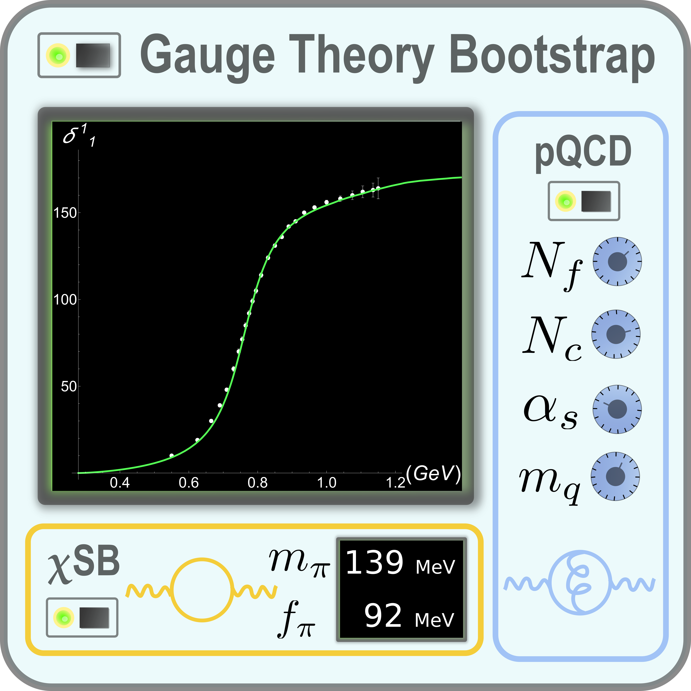

# Gauge Theory Bootstrap (QCD)

<p align="center">
  
</p>


This repository contains the **Gauge Theory Bootstrap** code applied to **QCD**.  
The workflow combines **Mathematica** and **Python**: Mathematica generates numerical kernels, Python runs the optimization, and Mathematica plots the results.

---

## Quickstart

Reproduce the basic GTB_QCD pipeline in three steps:

1. **Generate matrices (Mathematica)**  
   - Open `theories/qcd/GTB_program/gtb_generate_matrices.nb` in Mathematica.  
   - Evaluate the notebook.  
   - Output: matrices and kernels are written into  
     `theories/qcd/GTB_program/data/matrices/`.

2. **Run optimization (Python)**  
   - Open 'theories/qcd/GTB_program/gtb.ipynb' in Jupyter notebook and run 
   - Output: optimization results are saved into  
     `theories/qcd/GTB_program/data/results/` (in `.json` formats).

3. **Plot results (Mathematica)**  
   - Open `theories/qcd/GTB_program/mathematica/gtb_results_plot.nb`.  
   - Evaluate the notebook.  

**Pipeline:**  
👉 Mathematica (`gtb_generate_matrices.nb`) → Python (`gtb.ipynb`) → Mathematica (`gtb_results_plot.nb`)

---

## Repository layout

```text
gauge-theory-bootstrap/
├── README.md
└── theories/
    └── qcd/
        ├── GTB_program/
        │   ├── gtb_generate_matrices.nb
        │   ├── gtb.ipynb
        │   ├── gtb_results_plot.nb
        │   ├── data/
        │   │   ├── matrices/
        │   │   └── results/
        │   └── Phi_compute/
        │
        └── papers/          ← snapshots associated with previous papers
            ├── arxiv-2403.10772/
            └── arxiv-2505.19332/

```

---

## Requirements

- **Mathematica** 
- **Python**   
  - need mosek fusion [MOSEK license](https://www.mosek.com/products/academic-licenses/)   

---

## Paper snapshots

This program has been used in several papers, with more developments ongoing. To ensure reproducibility, we provide snapshots of the code used for each one:

- **Bootstrapping gauge theories**  
  - [arXiv:2309.12402](https://arxiv.org/abs/2309.12402)  
  - Original proposal of the Gauge Theory Bootstrap.  
  - No public code was provided at the time.

- **Gauge Theory Bootstrap: Pion amplitudes and low energy parameters**  
  - [arXiv:2403.10772](https://arxiv.org/abs/2403.10772)  
  - First released version of the program.  
  - Snapshot archived under:  
    `theories/qcd/papers/arxiv-2403.10772/`.

- **The Gauge Theory Bootstrap: Predicting pion dynamics from QCD**  
  - [arXiv:2505.19332](https://arxiv.org/abs/2505.19332)  
  - Current version of the program (main branch). 
  - Snapshot archived under:  
    `theories/qcd/papers/arxiv-2505.19332/`.
